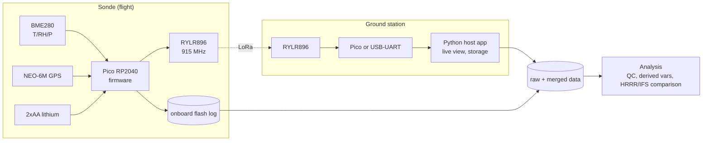

# balloonsonde

A cheap, simple, license-free DIY weather balloon radiosonde. It measures temperature, humidity, pressure and GPS position on the way up and down, sends it to the ground over 915 MHz LoRa, and logs everything onboard. The goal is science-quality profiles you can compare against model output (HRRR, IFS).

**Status:** parts received. M1 bring-up scripts written; flight firmware not written yet. See [docs/roadmap.md](docs/roadmap.md).

## Goals

- Under about $200 for a first flight, with reusable tools.
- No amateur radio license (license-free 915 MHz ISM LoRa, Part 15 certified module, stock antenna).
- Payload around 100 g, well under the FAA Part 101 exemption limits.
- Simple enough to build with through-hole soldering and one microcontroller.
- Clean data: profiles of T, RH, P and GPS altitude that can be verified against HRRR and IFS.

## Non-goals (for now)

- Replacing an operational radiosonde (no radiation-corrected sensors, no dual-sensor redundancy).
- 70 cm or other amateur-band telemetry (needs a license).
- Fancy flight termination or cut-down hardware.

## System overview

## Repository layout

| Path | Contents |
|---|---|
| `docs/hardware.md` | Parts list, pin map, wiring, build notes, mass budget |
| `docs/legal-and-safety.md` | FAA Part 101 and radio notes, safety |
| `docs/firmware-spec.md` | Sonde firmware requirements and design |
| `docs/telemetry-protocol.md` | Radio settings and packet format |
| `docs/ground-station-spec.md` | Receiver firmware and host software |
| `docs/data-pipeline-spec.md` | QC, derived variables, model comparison |
| `docs/m1-hello-hardware.md` | First bring-up: flash MicroPython and test each part |
| `docs/test-plan.md` | Staged tests with pass/fail criteria |
| `docs/flight-ops.md` | Lift calculation, fill, launch checklist, recovery |
| `docs/roadmap.md` | Milestones and open questions |
| `hardware/bom.csv` | Parts list as a table |
| `firmware/sonde/` | Flight firmware (to be written) |
| `ground/` | Receiver and host software (to be written) |
| `analysis/` | Data processing and model comparison (to be written) |

## Disclaimer

This is a hobby project written by someone who is not a lawyer. Check the current FAA and FCC rules yourself before flying. See [docs/legal-and-safety.md](docs/legal-and-safety.md).

## License

MIT. See [LICENSE](LICENSE).
