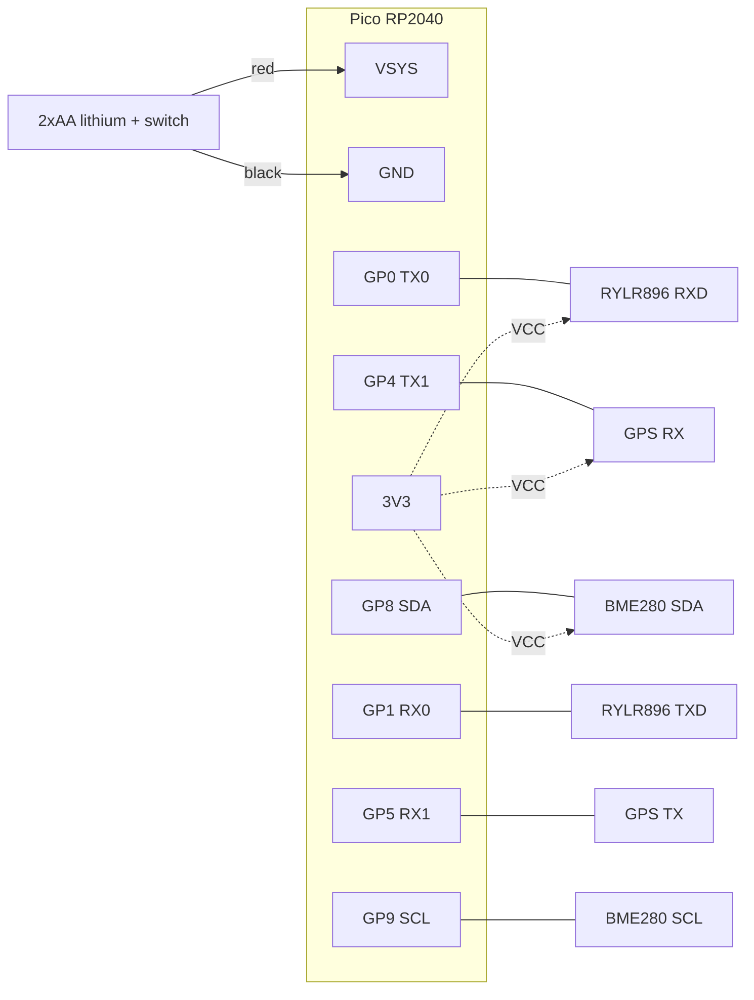

# Hardware

Parts and prices are in [`hardware/bom.csv`](../hardware/bom.csv). This page covers wiring, build notes and the mass budget.

## Pin map (sonde Pico)

| Function | Pico pin | Connects to |
|---|---|---|
| Battery + | VSYS (pin 39) | Battery holder red lead (via switch) |
| Battery - | GND | Battery holder black lead |
| 3.3 V out | 3V3 (pin 36) | VCC on GPS, BME280, RYLR896 |
| UART0 TX | GP0 (pin 1) | RYLR896 RXD |
| UART0 RX | GP1 (pin 2) | RYLR896 TXD |
| UART1 TX | GP4 (pin 6) | GPS RX |
| UART1 RX | GP5 (pin 7) | GPS TX |
| I2C0 SDA | GP8 (pin 11) | BME280 SDA |
| I2C0 SCL | GP9 (pin 12) | BME280 SCL |
| ADC3 | GP29 | Reads VSYS/3 internally (battery voltage) |

Notes:

- TX and RX cross over (Pico TX goes to the module's RX).
- All modules are 3.3 V logic. Do not feed them 5 V.
- Battery goes to VSYS, never to the 3V3 pin. The Pico's regulator makes 3.3 V from 1.8-5.5 V.
- Give every module a ground wire back to a Pico GND pin.

## Build notes

- **Layout:** solder female sockets on the perfboard so the Pico, radio, GPS and BME280 plug in and can be swapped. A no-solder fallback is female-to-female Dupont jumpers.
- **Sensor placement:** put the BME280 on a short boom outside the housing, shielded from sunlight with foil, away from the battery and the Pico (they warm up). Keep it clear of the radio antenna.
- **GPS antenna:** mount the ceramic patch facing up, with a clear view of the sky. Do not put foil above it.
- **Radio antenna:** keep the spring antenna vertical and away from the GPS patch.
- **Housing:** a foam cup or small foam box holds the board and batteries and gives thermal insulation. Cells should stay warm.
- **Batteries:** Energizer Ultimate Lithium AA only. Alkaline cells fail in the cold.
- **Hookup wire:** use silicone wire, one color per signal (two colors for each TX/RX pair) so nothing gets crossed.

## Mass budget (estimates, weigh the real parts)

| Item | Approx. mass |
|---|---|
| 2 lithium AA | 30 g |
| 2xAA holder with switch | 12 g |
| GPS board + patch antenna | 12 g |
| Perfboard, sockets, wire | 13 g |
| Foam housing, foil, cord | 12 g |
| Pico, radio, BME280 | 8 g |
| **Total** | **about 90-100 g** |

Add a parachute and its line when you weigh the final package. Keep the whole payload under about 150 g to keep the lift calculation simple.

## Power estimate

Average draw is roughly 80-100 mA (Pico about 25 mA, GPS about 45 mA, radio transmit bursts up to about 120 mA, BME280 about 1 mA). Two lithium AA cells at about 3000 mAh give well over a day of runtime, far more than a 2-3 hour flight needs. Estimates only; measure with a multimeter on the bench.
